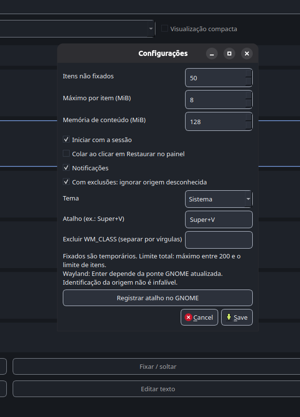
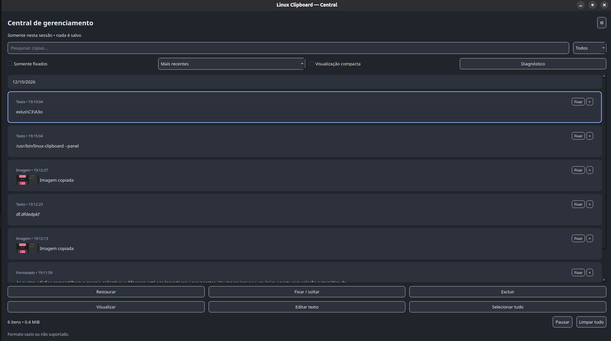
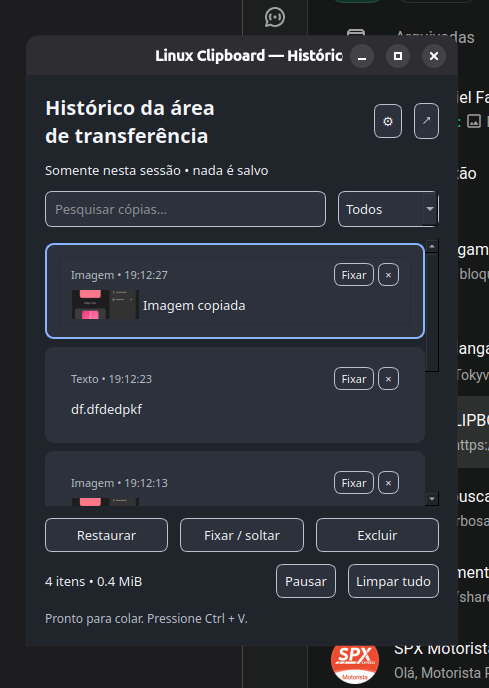

# MV Clipboard

Histórico da área de transferência para Linux, no estilo do **Super + V do Windows 11**: monitora texto e imagens em segundo plano, guarda o histórico localmente e abre uma janela flutuante (frameless, transparente, sempre no topo) com o seu HTML Fluent. Clicar num item devolve o conteúdo ao clipboard, fecha a janela e cola com Ctrl+V na janela que estava ativa.

Alvo: Zorin OS 17/18 (e Ubuntu/Debian em geral), **X11 e Wayland**.

## Estado dos testes (leia antes de rodar)

- Automatizado: testes em Node cobrindo sessão/estratégias, histórico, caixa de mensagens, colar, posição da janela, monitor, doctor os scripts de instalação (nvm/Node, autostart, GNOME) com ferramentas falsas, e o fluxo completo do processo principal com Electron simulado (nas duas gerações da API de clipboard, incluindo as Configurações); testes de DOM do renderer com jsdom (opcional: `npm i -D jsdom` habilita; sem ele são pulados).
- Tipos: o código passa na checagem de tipos contra as definições oficiais do Electron 43 e 44.
- **Não validado em tela real.** O ambiente em que foi escrito não tem display nem D-Bus. O primeiro `mv-clipboard` no seu Zorin é o teste de fumaça; `npm run doctor` aponta o que faltar.
- A extensão GNOME (43/44 e 45+) não foi carregada num GNOME Shell real.

## Instalação no Zorin OS

Um comando faz tudo (pede a senha do sudo só onde precisa):

```bash
bash install.sh
```

Ele roda, nesta ordem: **1)** `scripts/install-deps.sh` (pacotes do apt) · **2)** Node.js ≥ 22.12 · **3)** `scripts/install-app.sh` (npm install, CSS, chrome-sandbox, launcher e inicialização automática) · **4)** `scripts/setup-gnome.sh` (Super+V + extensão, só se o desktop for GNOME) · **5)** inicia o app. Opções: `--dry-run` (só mostra o que faria), `--skip-deps`, `--skip-gnome`, `--no-start`, `--wayland-extras`. Em sessão Wayland, **saia e entre de novo na sessão** para o GNOME carregar a extensão.

**Node.js ≥ 22.12.** O pacote do Electron 43 declara `engines: node >= 22.12.0`. Se o `node` do sistema for mais antigo (ou não existir), o instalador baixa o **nvm** (v0.40.8), roda `nvm install 22 && nvm use 22`, define o 22 como padrão (`nvm alias default 22`) e valida com `node -v`. O launcher do app roda o binário do Electron direto, então o app não depende do `node` estar no PATH da sessão. Só para conferir/instalar o Node: `bash scripts/ensure-node.sh`.

Passo a passo manual (equivalente):

```bash
bash scripts/install-deps.sh      # apt + Node >= 22.12 (nvm se preciso)
bash scripts/install-app.sh       # npm, CSS, sandbox, launcher, autostart
bash scripts/setup-gnome.sh       # GNOME/Zorin: atalho + extensão (--binding '<Control><Alt>v' para outro atalho)
npm run doctor                    # diagnóstico
mv-clipboard                      # iniciar agora
```

Desenvolvimento: `npm start` (compila o CSS e abre o app com `--ozone-platform=x11`). Testes: `npm test`.

### Inicialização automática

O instalador cria `~/.config/autostart/mv-clipboard.desktop` (padrão freedesktop: vale no GNOME, Xfce, KDE...), com `Exec` apontando para `~/.local/bin/mv-clipboard` e um atraso de 3 s para o XWayland subir. Para ligar ou desligar sem o instalador: o interruptor **Iniciar com o sistema** nas Configurações, ou `bash scripts/autostart.sh enable|disable|status`.

## Configurações (botão da engrenagem)

A engrenagem do cabeçalho abre a tela de Configurações dentro do próprio painel (uma segunda janela perderia o foco e fecharia o painel). Tudo vale **na hora**, sem reiniciar. Esc volta ao histórico.

```
Seção	Opção	O que faz
Atalho	Abrir o histórico	lista (Super+V, Ctrl+Alt+V, Ctrl+Shift+V...) ou "Gravar…" para capturar a combinação (precisa de Ctrl, Alt ou Super). No GNOME grava no gsettings (X11 e Wayland); em X11 fora do GNOME usa o globalShortcut; em Wayland fora do GNOME mostra a instrução para registrar `mv-clipboard-ctl toggle` no compositor
Inicialização	Iniciar com o sistema	cria/remove o arquivo de autostart
Inicialização	Mostrar a janela ao iniciar	abre o painel assim que o app sobe
Comportamento	Fechar ao clicar fora	liga/desliga o fechamento por perda de foco
Comportamento	Posição da janela	canto inferior direito ou perto do cursor (cursor só é confiável em X11 puro)
Comportamento	Itens no histórico	25 a 500 (reduzir apaga os mais antigos não fixados na hora)
Aparência	Opacidade do painel	40% a 100% com prévia ao arrastar (sem blur real do desktop no Linux)
Aparência	Cor de destaque	6 cores (selo de fixado, item selecionado, interruptores)
Dados	Apagar todo o histórico	confirma com um segundo clique; apaga também os fixados
Dados	Encerrar o MV Clipboard	confirma com um segundo clique (não há ícone na bandeja; ele volta no próximo login)
```

As opções ficam em `~/.config/mv-clipboard/config.json`, validadas por um esquema único (`src/config.js`): valores inválidos vindos da tela ou do arquivo são recusados/ignorados. O estado de **autostart** e o **atalho do GNOME** são lidos do próprio sistema (o arquivo `.desktop` e o gsettings), então mudanças feitas fora do app aparecem corretamente na tela.

## Pacotes do sistema

```
Pacote	Para quê	Obrigatório?
xdotool	colar (Ctrl+V) em X11/XWayland e ativar a janela do app	sim
Node.js >= 22.12 (nvm)	instalar e compilar (exigência do Electron 43); o instalador cuida	sim
libglib2.0-bin	gsettings, gdbus, gnome-extensions	GNOME/Zorin (já vem instalado)
python3	scripts de configuração do GNOME	GNOME/Zorin (já vem instalado)
wl-clipboard	wl-paste --watch para capturar no Wayland	só Wayland fora do GNOME (KDE, Sway, Hyprland)
wtype	colar em Sway/Hyprland (protocolo virtual-keyboard)	opcional
ydotool + ydotoold	colar em qualquer Wayland via /dev/uinput	opcional
```

`xclip` e `xsel` não são necessários: no X11 o app usa a API de clipboard do próprio Electron.

## Arquitetura

```
 Super+V ─► gsettings (GNOME) ─► mv-clipboard-ctl toggle ─► inbox/*.json ──┐
                                                                            │ inotify
 GNOME Shell                                                                ▼
  └ extensão MV Clipboard Bridge ─ copiou algo ─► inbox/clip.json ─►  PROCESSO PRINCIPAL (Electron)
        ▲                                                              ├ monitor: poll | wl-paste --watch | ponte
        └──────── colar ◄── shell/paste.json ◄─────────────────────────├ store: history.json + images/*.png
                                                                       ├ paste: ponte | xdotool | ydotool | wtype
                                                                       └ janela frameless transparente ─► renderer (seu HTML + Tailwind local)
```

Comunicação por "caixas de correio" em `$XDG_RUNTIME_DIR/mv-clipboard` (arquivos atômicos + inotify): sem D-Bus, sem módulo nativo, e o `mv-clipboard-ctl` (um script `sh`) responde em ~3 ms, sem subir outro Electron a cada Super+V.

```
Decisão	Motivo
Electron (não Tauri)	renderiza o seu HTML/CSS exatamente como no Chromium e tem janela transparente estável; o WebKitGTK do Tauri tem histórico de problemas com janela transparente e GPU. O custo é peso (~100–150 MB). A arquitetura (extensão + caixas + ctl) serve a um app Tauri depois.
Forçar XWayland (--ozone-platform=x11)	o Electron recente usa Wayland nativo, onde o app não consegue posicionar a janela nem ler o cursor. Em XWayland ficam previsíveis posição, foco, sempre-no-topo e transparência. O app se relança uma vez sozinho se faltar a flag.
Extensão GNOME	o Mutter não implementa o protocolo data-control do Wayland: nenhum app comum monitora o clipboard em segundo plano. Dentro do Shell dá (Meta.Selection). A mesma extensão injeta o Ctrl+V sem ydotool nem permissão em /dev/uinput.
Atalho pelo gsettings (não globalShortcut)	no Wayland o globalShortcut não é global; no GNOME o Super+V já pertence à bandeja de notificações. O script libera esse atalho e registra o nosso.
Histórico em JSON (não SQLite)	zero dependência nativa; a interface do Store é pequena e dá para trocar por SQLite sem mexer no resto.
```

## A janela frameless transparente

`src/window.js` (resumo):

```js
new BrowserWindow({
  width: 380 + 48, height: 580 + 48,   // painel do protótipo + 24 px de folga para a sombra não ser cortada
  show: false, frame: false, transparent: true, backgroundColor: '#00000000',
  resizable: false, skipTaskbar: true, alwaysOnTop: true,
  webPreferences: { preload, contextIsolation: true, sandbox: true, nodeIntegration: false },
});
```

- Clicou fora = fecha (evento `blur`, com tolerância de 350 ms). Alt+F4 só esconde; o app segue monitorando.
- Posição: canto inferior direito da área útil do monitor primário (`position: "cursor"` coloca junto ao ponteiro, confiável só em X11 puro).
- Ao abrir, o app pede `xdotool windowactivate`: o Mutter bloqueia "roubo de foco" de janelas mostradas sem evento de usuário, e esse pedido de "pager" ele sempre aceita.
- **Sem blur real do desktop.** `backdrop-filter` só desfoca o que está dentro da própria página; com janela transparente não há nada ali. O GNOME não oferece blur-atrás para apps. Por isso `--mica-bg` ficou em `0.88` (no protótipo era `0.65`) para manter o texto legível; volte a `0.65` em `renderer/input.css` se preferir. O menu de contexto continua com acrílico real, porque desfoca os cards que estão atrás dele.
- Adaptações do HTML: sem CDN (Tailwind compilado localmente), sem `@import` de fontes, sem wallpaper de fundo, sombra menor para caber na janela, cards gerados dinamicamente com as mesmas classes do protótipo, "Sincronizar dispositivos" visível porém desativado.

## Compatibilidade

```
Ambiente	Captura	Super+V	Colar (Ctrl+V)
X11 (Xorg), qualquer desktop	polling da API do Electron	GNOME: gsettings; Xfce/Cinnamon/MATE: globalShortcut	xdotool
GNOME/Zorin + Wayland	extensão (completa) + polling XWayland (só apps X11)	gsettings → mv-clipboard-ctl	extensão; xdotool só atinge apps X11
KDE, Sway, Hyprland + Wayland	wl-paste --watch + polling XWayland	atalho do compositor → mv-clipboard-ctl toggle	ydotool, wtype (só wlroots) ou xdotool (apps X11)
```

Em terminais o app cola com **Ctrl+Shift+V** (detecta pela classe da janela). Só a extensão GNOME e o xdotool conseguem detectar; ydotool/wtype mandam Ctrl+V comum.

### Wayland fora do GNOME

Registre o atalho no compositor:

```
# Sway (~/.config/sway/config)          bindsym Mod4+v exec mv-clipboard-ctl toggle
# Hyprland (~/.config/hypr/hyprland.conf) bind = SUPER, V, exec, mv-clipboard-ctl toggle
# KDE: Configurações do Sistema → Atalhos → Adicionar comando → mv-clipboard-ctl toggle
```

Para colar sem xdotool use `wtype` (Sway/Hyprland) ou `ydotool`. Atenção: os repositórios do Ubuntu/Zorin têm o **ydotool 0.1.8** (antigo): precisa do `ydotoold` rodando e permissão de escrita em `/dev/uinput` (regra udev com a tag `uaccess` ou grupo `input`). O app usa códigos de tecla do kernel (`29:1 47:1 47:0 29:0`), compatíveis com 0.1.x e 1.x.

## Configuração

`~/.config/mv-clipboard/config.json` (qualquer chave é opcional; a tela de Configurações edita as primeiras):

```
Chave	Padrão	Efeito
hotkey	Super+V	atalho para abrir/fechar (formato Electron: Ctrl+Alt+V)
showOnStart	false	mostra a janela ao iniciar
closeOnBlur	true	fecha ao clicar fora
opacity	0.88	opacidade do painel (0.4 a 1)
accent	#60CDFF	cor de destaque (#RRGGBB)
maxItems	50	itens não fixados mantidos, de 5 a 500 (fixados nunca são apagados)
maxTextBytes	1000000	ignora textos maiores
maxImageBytes	12000000	ignora imagens maiores
pollMs	600	intervalo do polling (X11/XWayland)
position	bottom-right	"bottom-right" ou "cursor"
margin	12	distância da borda da área útil (px)
pasteDelayMs	140	espera o foco voltar antes do Ctrl+V
blurGraceMs	350	tolerância do "clicou fora" logo após abrir
monitor	auto	auto, poll, wl-watch ou bridge
paste	auto	auto, bridge, xdotool, ydotool ou wtype
```

Variáveis de ambiente: `MVCLIP_DISABLE_GPU=1` (janela preta), `MVCLIP_NO_SANDBOX=1` (só se o chrome-sandbox não puder ser configurado), `MVCLIP_NATIVE_WAYLAND=1` (não forçar XWayland; sem posicionamento), `MVCLIP_FORCE_GLOBALSHORTCUT=1`.

Comandos: `mv-clipboard-ctl toggle|show|hide|quit`.

## Problemas comuns

```
Sintoma	Causa provável	O que fazer
"The SUID sandbox helper binary was found, but is not configured correctly"	Ubuntu 24.04/Zorin 18 restringem user namespaces (AppArmor)	sudo chown root:root node_modules/electron/dist/chrome-sandbox && sudo chmod 4755 node_modules/electron/dist/chrome-sandbox (o install-app.sh já faz)
npm install reclama de engine (EBADENGINE) ou o Electron não instala	Node < 22.12	bash scripts/ensure-node.sh (instala nvm + Node 22); abra um terminal novo para o nvm entrar no PATH
O app não abre sozinho no login	autostart desligado ou removido	bash scripts/autostart.sh status; ative em Configurações → Iniciar com o sistema
Janela preta ou sem transparência	driver/GPU com compositor	MVCLIP_DISABLE_GPU=1 mv-clipboard
Super+V ainda abre a bandeja de notificações	atalho do GNOME não foi liberado	bash scripts/setup-gnome.sh e npm run doctor
Atalho não faz nada	app não está rodando	rode mv-clipboard; teste mv-clipboard-ctl toggle no terminal
GNOME/Wayland não captura cópias de alguns apps	extensão inativa	saia e entre na sessão; gnome-extensions enable mv-clipboard-bridge@mv.local; npm run doctor
Extensão aparece como "out of date"	versão do GNOME fora de shell-version	acrescente a versão em gnome-extension/esm/metadata.json e reinstale
Colar não funciona	sem extensão, xdotool, ydotool ou wtype para o seu caso	npm run doctor mostra a cadeia de colagem; o item já está no clipboard, cole manualmente
Janela abre no meio da tela	rodando em Wayland nativo	use o launcher mv-clipboard (força XWayland)
Janela abre mas não recebe teclado	WM negou o foco	confirme que xdotool está instalado
```

## Limitações conhecidas

- Guarda **texto puro e PNG**. HTML/RTF, arquivos e GIFs animados não são preservados (por isso "Colar como texto simples" equivale a colar normal).
- O histórico fica em `~/.config/mv-clipboard/history.json` (permissão 0600, **em texto claro**). Conteúdo marcado por gerenciadores de senha (`x-kde-passwordManagerHint`) é ignorado; senhas copiadas de outras fontes, não. Use "Limpar tudo" quando necessário.
- Sincronização entre dispositivos não existe (o item aparece desativado no menu).
- Gravar atalho: combinações que o sistema já captura (inclusive o próprio Super+V enquanto está ativo) não chegam à tela; use a lista de atalhos.
- Wayland sem XWayland: o app abre, mas o compositor decide a posição.
- **Electron 44 mudou o clipboard** (API assíncrona; `readImage`, `writeImage` e `availableFormats` foram removidos). O projeto fixa `^43` e traz um adaptador (`src/clip-adapter.js`) para o 44+; esse caminho está testado só com Electron simulado.
- Extensão GNOME declarada para o Shell 43–44 (`legacy/`) e 45–49 (`esm/`). Versões futuras podem exigir ajuste.

## Arquivos

```
Arquivo	Função
install.sh	instalador de ponta a ponta (apt, Node >= 22.12, app, GNOME, iniciar)
main.js	orquestra tudo: flags X11, instância única, IPC, caixa de mensagens, colar, configurações
src/session.js	detecta X11/Wayland/desktop/ferramentas e escolhe as estratégias
src/clip-adapter.js	clipboard do Electron: API síncrona (≤43) e assíncrona (≥44) numa interface só
src/monitor.js	captura: polling, wl-paste --watch, itens vindos da extensão
src/store.js	histórico (history.json + images/), dedupe, fixados, limite
src/mailbox.js	caixas de correio (inotify) e batimentos app/extensão
src/paste.js	Ctrl+V: ponte, xdotool, ydotool, wtype; detecção de terminal
src/window.js	janela frameless transparente e posicionamento
src/hotkey.js	atalho: gsettings (GNOME), globalShortcut (X11) ou manual (Wayland fora do GNOME)
src/accelerator.js	atalhos Electron <-> GNOME e validação
src/config.js	esquema das configurações (padrões + validação) e config.json
src/settings.js	configurações vivas (objeto compartilhado)
src/autostart.js	~/.config/autostart/mv-clipboard.desktop
src/doctor.js	diagnóstico (npm run doctor)
src/preload.js	única API exposta ao HTML
renderer/	index.html, input.css (Tailwind + seu CSS), renderer.js (cards), settings.js (tela de Configurações)
gnome-extension/esm, legacy	ponte do GNOME Shell (45+ e 43/44)
bin/mv-clipboard, mv-clipboard-ctl	launcher (força XWayland) e comando do atalho
scripts/	install-deps.sh, ensure-node.sh (nvm + Node 22), install-app.sh, autostart.sh, setup-gnome.sh
test/	testes (node --test)
```

# 📦 Demo / CAPA

<div align="center">

### 📸 Capturas de Tela

<p float="left">
  
  
  
</p>

### 🎥 Demonstração em Vídeo

<video width="250" controls>
  <source src="CAPA/v14771g5000cdb80mr7og65lc4sva440.mp4" type="video/mp4">
  Seu navegador não suporta o tag de vídeo.
</video>

</div>

*Materiais da pasta `CAPA/` — ideais para divulgação no GitHub e redes sociais.*

## Próximos passos sugeridos

SQLite no lugar do JSON; ícone na bandeja; empacotamento (.deb/AppImage com electron-builder); preservar HTML/RTF; busca no histórico; tema claro.
